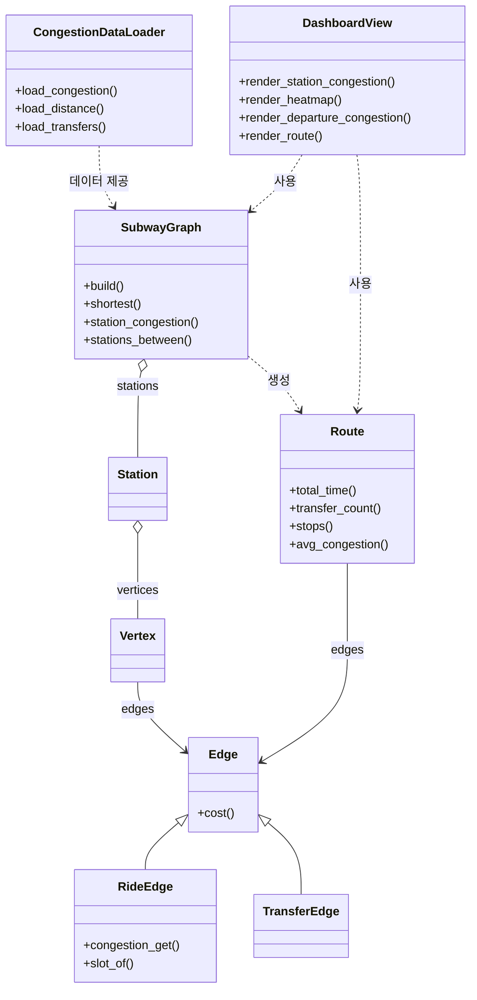

# 지하철 혼잡도 기반 경로 추천 대시보드

객체지향프로그래밍 팀 프로젝트입니다. 서울교통공사의 지하철 혼잡도, 역간거리, 환승시간 데이터를 객체지향 구조로 관리하고, 혼잡도 그래프와 두 역 사이 최소 이동시간을 보여 주는 대시보드입니다.

- 대시보드: https://object-oriented-programming-8-team.vercel.app/
- 저장소: https://github.com/youngjunegkim/Object-Oriented-Programming-8-team-

---

## 1. 프로젝트 개요

대시보드는 역별 혼잡도 조회와 구간 소요시간 조회 기능을 제공합니다. 이동 구간의 혼잡도를 그래프로 보여 주고, 호선 전체 혼잡도는 히트맵으로 나타냅니다.

혼잡도와 역간 이동시간 데이터를 객체로 만들어 관리하고, 이용자가 고른 역·요일·시간대·방향으로 데이터를 걸러서 구간 소요시간과 혼잡도를 계산합니다. 이 계산을 바탕으로 두 역 사이의 최소 이동시간을 구합니다.

## 2. 실행 방법

현재 배포된 페이지는 프로젝트 안내용 정적 HTML입니다. 저장소를 내려받은 뒤 `index.html` 파일을 브라우저에서 열면 확인할 수 있습니다.

```bash
git clone https://github.com/youngjunegkim/Object-Oriented-Programming-8-team-.git
```

최종 대시보드 구현에 필요한 패키지 설치 방법과 실행 명령은 개발 완료 후 이 항목에 추가할 예정입니다.

## 3. 사용 데이터

| 구분 | 데이터 | 사용 목적 |
|---|---|---|
| 기본 데이터 | 서울교통공사_지하철혼잡도정보_20260630 | 역·방향·시간대별 혼잡도 |
| 추가 데이터 1 | 서울교통공사_역간거리 (소요시간 포함) | 혼잡도 데이터에는 역 사이 이동 시간이 없어서, 경로 탐색에 쓸 구간(Edge)의 소요시간과 거리를 채움 |
| 추가 데이터 2 | 서울교통공사_환승역거리 소요시간 정보 | 두 역의 최소시간을 구할 때 환승시간을 반영 |

데이터 내용은 다음과 같습니다.
- **혼잡도**: 평일·토요일·일요일 시트, 05:30부터 25:00까지 30분 단위 39개 시간대, 1~8호선 상선·하선(2호선은 내선·외선) 별 혼잡도(%)
- **역간거리**: 1~8호선 각 역의 앞 역으로부터의 소요시간(분:초)과 거리(km)
- **환승시간**: 1~8호선 환승역의 호선 간 환승 거리(m)와 소요시간(분:초)

참고할 점은 다음과 같습니다.
- 1~8호선만 다루며 9호선과 경의중앙선 등은 포함하지 않습니다.
- 환승시간은 걸어서 이동하는 시간만 있고, 열차를 기다리는 시간은 포함하지 않습니다.
- 혼잡도 값은 역 단위라서, 구간의 혼잡도는 해당 구간의 출발역 값으로 계산합니다.

## 4. 클래스 설계 및 객체 간 상호작용

### 4-1. 클래스 구조



### 4-2. 클래스별 역할

| 클래스 | 주요 책임 | 주요 속성 | 주요 메서드 |
|---|---|---|---|
| CongestionDataLoader | 혼잡도, 역간거리, 환승시간 데이터를 읽어 호선별 행 순서를 만들고 역 이름을 정규화 | days(평일·토요일·일요일), time_slots(30분 단위 시간대) | load_congestion, load_distance, load_transfers |
| Station | 물리적 역 하나를 나타내고, 그 역의 호선별 Vertex를 한 묶음으로 관리 | name, vertices | add_vertex |
| Vertex | 한 역의 한 호선을 그래프의 정점으로 나타내고, 여기서 출발하는 이동 구간을 보관 | station, line, edges | add_edge |
| Edge | 두 Vertex를 잇는 구간 (부모 클래스) | from_v, to_v, seconds | cost |
| RideEdge | 같은 호선에서 인접한 두 역 사이를 열차로 이동하는 구간 | distance, direction, congestion(day, slot) | congestion_get, slot_of |
| TransferEdge | 같은 역에서 호선을 갈아타는 이동 | seconds(환승 소요시간) | cost |
| SubwayGraph | 전체 역·구간 객체를 만들고 관리하며 경로를 탐색 | stations, vertices, edges, line_order | build, shortest, station_congestion, stations_between |
| Route | 탐색된 경로 하나의 정보를 요약 | edges, day, slot | total_time, transfer_count, stops, avg_congestion |
| DashboardView | 사용자 입력을 받아 그래프에 요청하고 결과를 화면에 출력 | graph, 선택 상태(호선·방향·요일·시간대) | render_station_congestion, render_heatmap, render_departure_congestion, render_route |

### 4-3. 클래스 구조 설명

CongestionDataLoader가 혼잡도, 역간거리, 환승시간 파일을 읽어서 정리하면, SubwayGraph가 이 데이터로 지하철 지도를 만들고 두 역 사이 최소 소요시간을 찾습니다.

지하철 지도는 Station, Vertex, Edge로 이루어집니다. Station은 역 하나이고, Vertex는 그 역의 호선별 정점입니다. 예를 들어 서울역은 1호선 Vertex와 4호선 Vertex를 가집니다. Edge는 Vertex와 Vertex를 잇는 구간입니다. 같은 호선을 타는 구간은 RideEdge, 같은 역에서 호선을 갈아타는 구간은 TransferEdge이며, 둘 다 Edge를 상속받습니다. 두 클래스 모두 `cost()`로 걸리는 시간을 돌려주기 때문에, 경로를 찾을 때 탑승과 환승을 같은 방식으로 계산할 수 있습니다.

사용자가 출발역과 도착역을 고르면 SubwayGraph가 Vertex에 연결된 Edge를 따라가며 최소 시간 경로를 찾습니다. 찾은 경로는 Route에 담기고, Route는 소요시간, 환승 횟수, 정거장 수, 평균 혼잡도를 계산합니다. DashboardView는 계산된 값을 그래프, 히트맵, 요약 카드로 보여 줍니다.

### 4-4. 처리 흐름

| 단계 | 입력 / 상태 | 수행 객체 | 결과 |
|---|---|---|---|
| 1 | 혼잡도 엑셀(평일·토요일·일요일), 역간거리, 환승시간 데이터 | CongestionDataLoader | 요일·역번호·방향별 시간대 혼잡도, 호선별 (역명, 소요시간, 거리) 목록, 호선 간 환승 소요시간 |
| 2 | 정제된 데이터 | SubwayGraph → Station, Vertex, RideEdge, TransferEdge | 전체 지하철 그래프 (stations, vertices, edges, line_order) |
| 3 | 사용자 선택: 역, 방향, 요일 | DashboardView → SubwayGraph | 요일별 시간대 혼잡도 선 그래프 |
| 4 | 사용자 선택: 호선, 방향, 요일 | DashboardView → SubwayGraph | 호선 전체 역 × 시간대 혼잡도 히트맵 |
| 5 | 사용자 선택: 출발역, 도착역(같은 호선), 요일, 시간대 | DashboardView → SubwayGraph | 구간 내 역별 혼잡도, 가장 혼잡한 지점, 출발 시간대별 평균 혼잡도 |
| 6 | 사용자 입력: 출발역, 도착역 | DashboardView → SubwayGraph → Vertex → Edge | 최소 소요시간 경로(Route) |
| 7 | 탐색된 Route, 요일, 시간대 | Route → Edge | 최소 소요시간, 환승 횟수, 정거장 수, 거리, 평균 혼잡도 |
| 8 | 3~7단계 결과 | DashboardView | 혼잡도 선 그래프, 호선 히트맵, 구간 혼잡도 막대, 출발 시간대 비교 그래프, 최소 이동시간 카드 |

### 4-5. 최소 소요시간을 구하는 방법

1. 역간거리 데이터의 한 행(앞 역 → 이 역)마다 RideEdge를 양방향으로 만듭니다. 소요시간은 초 단위로 저장합니다.
2. 환승시간 데이터로 같은 역의 서로 다른 호선 Vertex를 TransferEdge로 잇습니다.
3. 출발역의 모든 Vertex에서 시작해 Edge를 따라가며 `cost()`를 누적하는 다익스트라 알고리즘으로 도착역까지 가장 짧은 경로를 구합니다.
4. 이 경로를 Route에 담고, 요일과 출발 시간대에 맞는 혼잡도를 RideEdge에서 꺼내 평균 혼잡도를 계산합니다.

## 5. 대시보드 기능

| 화면 | 시각화 | 사용 방법 |
|---|---|---|
| 역별 혼잡도 조회 | 시간대별 혼잡도 선 그래프 (평일·토요일·일요일 비교, 100% 기준선 표시) | 역, 요일, 방향을 고르면 그래프가 나오고, 마우스를 올리면 그 시간대 값이 보임 |
| 호선 전체 혼잡도 히트맵 | 역 × 시간대 히트맵 (혼잡할수록 빨간색) | 호선, 방향, 요일을 고르면 호선 전체에서 언제 어디가 붐비는지 볼 수 있음 |
| 이동 구간 혼잡도 분석 | 구간 내 역별 혼잡도 막대그래프 (가장 혼잡한 역 강조) | 출발역, 도착역, 요일, 시간대를 고르면 구간 안 역마다 혼잡도와 가장 붐비는 역이 나옴 |
| 출발 시간대 비교 | 출발 시간대별 평균 혼잡도 막대그래프 (가장 덜 혼잡한 시간대 강조) | 출발역, 도착역, 요일을 고르면 같은 구간을 타는 시간대별 혼잡도를 비교하고 덜 붐비는 시간대를 알려 줌 |
| 최소 이동시간 조회 | 요약 카드(최소 소요시간, 환승 횟수, 정거장 수, 이동거리, 평균 혼잡도) + 이동 경로 | 출발역, 도착역(환승 포함), 요일, 시간대를 고르면 가장 빠른 경로와 요약 정보를 보여 줌 |
